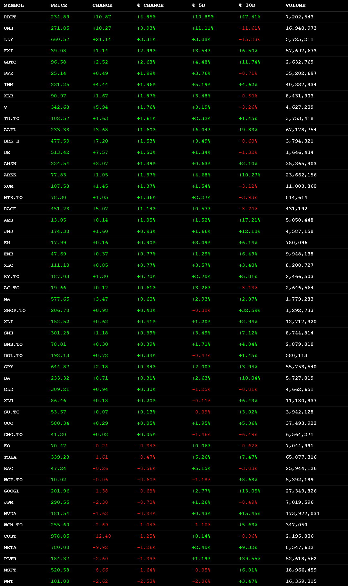

# Wall Street Price Board

A dynamic, interactive stock ticker wallpaper for Wallpaper Engine. Display live market data with customizable stock symbols, sorting options, and visual styling.

## Preview



**Video Demo**: [Watch Demo](preview/demo.mp4)

*Screenshot and demo video showing the interactive stock ticker in action*

## Features

- 📊 **Live Stock Data** - Real-time price updates for S&P 500 stocks
- 🎨 **Interactive Customization** - Adjust fonts, alignment, colors, and ticker lists directly in Wallpaper Engine
- 📈 **Advanced Sorting** - SAdapts to any screen resolution 5-day/30-day performance, or volume
- 📍 **Market Hours Detection** - Intelligent update scheduling based on NYSE hours (9:30 AM - 4:00 PM EST)
- 🎯 **Responsive Layout** - Optimized for 1920x1080 displays with customizable positioning

## Installation

1. Download this wallpaper from the [Steam Workshop](https://steamcommunity.com/sharedfiles/filedetails/?id=3537645205)
2. Subscribe in Wallpaper Engine
3. Select the wallpaper and customize settings to your preference

## Customization

The wallpaper supports the following settings in Wallpaper Engine:

| Setting | Description | Options |
| --------- | ------------- | --------- |
| **Ticker Symbols** | Comma-separated stock symbols (e.g., AAPL,MSFT,GOOGL) | Any valid ticker |
| **Sort Column** | Column to sort by | Price, Change, % Change, % 5d, % 30d, Volume, None |
| **Sort Direction** | Ascending or descending sort order | Ascending, Descending |
| **Show Stats Ribbon** | Display top performers ribbon | On/Off |
| **Vertical Alignment** | Position of ticker table | Top, Center, Bottom |
| **Horizontal Alignment** | Left-right positioning | Left, Center, Right |
| **Font Size** | Customize text size (px) | 8-48 |
| **Opacity** | Background transparency | 0-100% |

## Project Structure

```text
ticker_list_wallpaper/
├── index.html           # Main wallpaper HTML
├── board.js             # Stock data fetching & display logic
├── styles.css           # Wallpaper styling
├── wallpaper.json       # Wallpaper Engine configuration
├── README.md            # Documentation
├── LICENSE              # MIT License
├── .gitignore           # Git ignore rules
├── preview/             # Screenshots & previews
│   ├── preview.png      # Main preview screenshot
|   ├── preview_wide.png # Wide preview screenshot
│   ├── demo.mp4         # Demo video
|   └── demo.mkv         # Demo video (alternative format)


```

## Technical Details

- **Resolution**: Dynamic (adapts to any display)
- **Interactive**: Yes
- **API**: Uses public stock data endpoints for S&P 500 stocks
- **Update Frequency**:
  - Every 15-30 seconds during market hours
  - Daily at market open on weekdays
  - No updates on weekends/holidays

## Data Source

Stock prices are fetched from public financial data APIs. The wallpaper respects market hours to minimize unnecessary data requests during off-market times.

## Development

To modify this wallpaper:

1. Edit `board.js` for data fetching and logic changes
2. Modify `styles.css` for visual styling
3. Update `wallpaper.json` for configuration options
4. Test in Wallpaper Engine's editor

## Author

Mike

## License

This wallpaper is provided as-is for personal use.

---

**Wallpaper Engine Workshop**: [View on Steam](https://steamcommunity.com/sharedfiles/filedetails/?id=3537645205)
